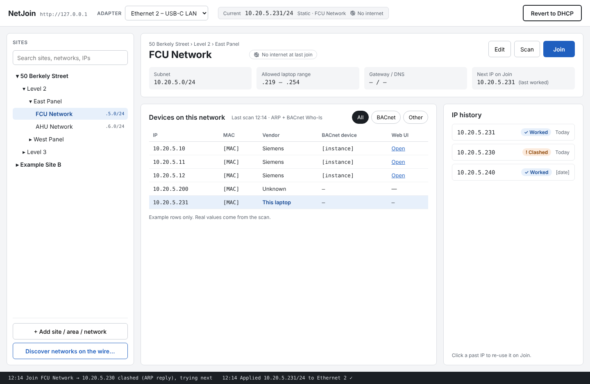

# NetJoin – Design Notes

_Last updated: 2026-11-19_

App name: **NetJoin**. Target: Windows 10+, engineers have local admin.

**Build phases:** 1 – tree, Join + clash check, DHCP / rejoin, history, internet check, gateway / DNS overrides, SQLite *(built, v0.1.0 – tested on Windows 2026-11-19: Join, clash detection via DAD, gateway override, Revert to DHCP all working)* · 2 – scans (ARP, ping, BACnet Who-Is, port check, Npcap detection) *(built, v0.2.1 – tested on Windows)* · 3 – Discover wizard, exe packaging polish *(built, v0.3.0 – Discover tested on Windows 2026-11-19)* · 4 – responsive layout for narrow windows (split-screen tabs, small browser windows) *(built, v0.4.0)*.

## Concept

A local tool for quickly switching a laptop's IP settings to get onto site networks (BMS controllers, plant networks and so on) without retyping adapter settings each time.

## Platform

- Runs on localhost.
- Used through an HTML front end in the browser.

## UI layout

Concept mockup: [Network Join Tool – Layout Concept](https://claude.ai/artifact/5DffGaspNq4tiB85YquNRD). It's based on the user's own sketch: a tree on the left, a header box top right and a main panel below it.



```
+--------------------------------------------------------------------------+
| NetJoin  [Adapter: Ethernet 2 v]  Current: 10.20.5.231/24 (no-net)  [DHCP] |  <- top bar, always visible
+------------------+-------------------------------------------------------+
| Search           |  Site > Area > Area                                    |
| v Site           |  FCU Network   (no internet at last join)              |
|   v Area         |                                [Edit] [Scan] [Join]    |
|     v Area       |  Subnet | Allowed range | Gateway/DNS | Next IP        |
|       > Net  <-- +-------------------------------------+-----------------+
|       > Net      |  Devices on this network            |  IP history     |
|   > Area         |  [All] [BACnet] [Other]             |  .231  Worked   |
| > Site           |  IP | MAC | Vendor | BACnet | Web   |  .230  Clashed  |
|                  |  ...                                |  .240  Worked   |
| [+ Add]          |                                     |                 |
| [Discover...]    |                                     |                 |
+------------------+-------------------------------------+-----------------+
| log: 12:14 .230 clashed (ARP), trying next · applied .231 OK             |  <- status / log strip
+--------------------------------------------------------------------------+
```

- **Top bar (always visible):** app name, adapter picker, current IP / mode / internet status, and the global **Revert to DHCP** button.
- **Left sidebar:** search box, then the Site › Area › Network tree; each network shows its subnet. At the bottom are **Add site / area / network** and **Discover networks on the wire**.
- **Network header (top right):** breadcrumb, network name, internet badge, **Edit / Scan / Join** buttons, and fact tiles: subnet, allowed laptop range, gateway / DNS, and the next IP Join will use (preferring the last IP that worked).
- **Devices panel:** results of the last scan (ARP + BACnet Who-Is): IP, MAC, vendor, BACnet device instance, and a web UI link. Filter by All / BACnet / Other. The laptop's own row is highlighted.
- **IP history panel:** past IPs on this network, tagged **Worked** or **Clashed**, with the date. Click one to re-use it on Join.
- **Status / log strip (bottom):** a running log of what the tool did (clash checks, IP applied, scans).

## Data model

- **Sites**, which contain **areas**, which contain **networks**. Areas can nest (e.g. Level 2 › East Panel).
- Each **network** has an IP range or subnet associated with it.
- Each network has a **whitelisted device address range** that the tool may assign from, default .200–.254 (editable per network), so it never hands out .1 (often the gateway) or addresses already used by controllers.

## Network setup

There are two ways to add a network to an area.

### 1. Manual entry

- Type in the subnet, mask and allowed device address range (plus gateway / DNS if needed).

### 2. Discover

Find the subnet from the traffic on the wire instead of typing it in. No IP range needed up front.

1. **Listen (passive):** sniff the physical network for 30–60 s without sending anything. BMS networks are chatty (BACnet I-Am / Who-Is, COV, ARP), so this often reveals controller IPs on its own. It's the gentlest option on a live site.
2. **Broadcast (active, optional):** send a BACnet Who-Is to 255.255.255.255 on UDP 47808. This reaches every device on the segment whatever subnet the laptop or the devices are on. Listen on a small port range (e.g. 47808–47812), because some sites don't use the default.
3. **Collect results:** the source IP of each I-Am packet gives the controller's IP. The I-Am also gives its device instance and vendor ID (to tag it as Siemens, Trend, etc.).
4. **Work out the subnet:** use the broadcast address the controllers send to (e.g. 10.20.5.255 → 10.20.5.0/24). Fall back to grouping the IPs found if there are no broadcasts.
5. **Suggest a network:** pre-fill subnet, mask and a free device address range (avoiding every IP seen). The user confirms or edits it, then saves it to the area.
6. **Join:** the normal clash check runs, then the IP is applied.

Technical notes:

- Needs raw packet capture (scapy; on Windows, Npcap). The OS may drop broadcast replies addressed to a subnet the laptop isn't on, but a raw capture still sees them.
- Controllers that reply **unicast** to an off-subnet laptop send the reply to their gateway, so those replies are lost. Passive listening covers this case.
- Broadcasts only cover the local physical segment. They don't cross routers.
- ⚠️ Based on how the protocol works; it hasn't been tested on a real site yet. First test target: a Desigo DXR2.E18 site.

## Core feature: Join

- Pick a network and click **Join**.
- The tool changes the IP settings of the **selected network adapter** so the laptop can reach that subnet.
- The address it picks comes from the network's whitelisted range.

## Safety check before applying

- Before applying, run a final check that the chosen IP doesn't clash with anything already on the local subnet.
- If it clashes, move on to the next free address in the whitelisted range.

**Decided – how the clash check works (Phase 1):**
- Before Join, an ARP check can't see the target subnet reliably, because the laptop isn't on it yet.
- So Join applies the candidate IP and then reads Windows' own **Duplicate Address Detection** (DAD) result (`netsh interface ipv4 show ipaddresses`). Windows ARP-probes every new address itself. If the state is `Duplicate`, the IP is marked **Clashed** and the next candidate is tried.
- Candidate order: last IP that worked on this network, then the allowed range from the bottom up.
- Phase 2 (with Npcap): an RFC 5227 ARP probe *before* applying, so a clashing IP is never put on the wire.

## Global DHCP button

- A **DHCP** button that's always visible at the top of every page, so you can drop the selected adapter back to DHCP from anywhere.

## History and status indicators

- Keep a history of joins, including the last IP addresses used on each network.
- Show an indicator next to each past IP: **worked before** or **clashed**.
- Show a small icon on each network that says whether it **had internet** the last time you joined it.

## Network scanning and discovery

Goal: locate hosts and controllers on the current subnet, and find BMS networks by broadcast, e.g. Siemens Desigo DXR2.E18.

### Host scan (IP / ARP)

- **ARP sweep** of the current subnet. This is the most reliable way to find hosts on the local segment, because devices answer ARP even when they ignore ping.
  - Python: `scapy` (on Windows, raw packets need Npcap installed).
- **Ping sweep** as a fallback when raw packets aren't available.
- Optional **port check** on common BMS ports to label what each host is (web UI 80/443, BACnet 47808/UDP, Modbus 502, etc.).
  - Could wrap `nmap` via `python-nmap` if nmap is installed, or do simple socket checks ourselves.
- The same ARP check can double as the **clash check** before a Join.

### BACnet discovery (UDP broadcast)

- DXR2.E.. controllers are BACnet/IP devices. Discovery means broadcasting a **Who-Is** on UDP 47808 (0xBAC0) and collecting the **I-Am** replies (device instance, vendor ID, address).
- Libraries:
  - **BAC0**: high-level, async, built on bacpypes3. Has discovery built in. Actively maintained.
  - **bacpypes3**: the lower-level stack underneath, with a `discover-devices` sample.
- Use the vendor ID in the I-Am to tag results as Siemens, Trend, etc.

### Phase 2 – as built (v0.2.0)

- **Scans run from the laptop's current subnet.** The Scan menu is disabled until the selected adapter is on the network's subnet (Join first). Devices are stored per subnet, so the list stays even if the network is renamed.
- **Scan menu:** Quick (ARP + BACnet, also the header *Scan* button) · ARP sweep · Ping sweep · BACnet Who-Is · BMS port check · Passive listen 30 s (Npcap) · Full (ARP + ping + BACnet + ports).
- **ARP sweep:** with Npcap, one raw ARP broadcast for the whole subnet (scapy, ~2 s); without Npcap, Windows `SendARP` per address, 64 at a time.
- **Ping sweep:** Windows `IcmpSendEcho2Ex` from the adapter's own IP (no PowerShell, no `ping.exe`), 64 at a time, shows response time.
- **Sweeps are limited to 1,024 addresses** (a /22). BACnet Who-Is still works on bigger subnets.
- **BACnet Who-Is:** our own small implementation (no BAC0 needed). Global Who-Is (DNET 0xFFFF, so routers pass it to MS/TP networks) sent to the subnet broadcast and 255.255.255.255 from UDP 47808 on the adapter's IP. Listens 3 s, then reads each device's **object-name, model-name and vendor-name** with ReadProperty. Devices behind routers (e.g. DXR2.M on MS/TP behind a PXC) are listed with their router IP and "net N, MAC M". If UDP 47808 is already used by another BACnet tool, NetJoin uses a random port and warns that broadcast replies may be missed.
- **BMS port check** on known hosts: 80 HTTP, 443 HTTPS, 8080, 502 Modbus TCP, 1911/4911 Niagara Fox, 22 SSH, 23 Telnet. Web ports become clickable links. *(Trend-specific ports to add once confirmed.)*
- **Passive listen (Npcap only):** 30 s sniff of ARP and UDP 47808–47823, sending nothing. Hosts seen on *other* subnets are logged; Phase 3 Discover will use them.
- **MAC addresses** come from the ARP sweep. After *any* scan, hosts still missing a MAC are looked up with Windows ARP (only the hosts found, not the whole subnet).
- **Vendor:** BACnet devices report their own vendor name (read from the device, e.g. "Trend Control Systems Ltd"); a small table of BACnet vendor IDs is the fallback. Every other host gets its **MAC manufacturer** from the offline Wireshark list bundled with scapy. That names the network chip maker, which is usually but not always the brand. Randomised (private) MACs from phones/laptops are labelled as such.
- **This PC:** the scanning computer is listed as "This PC" with its hostname and MAC (not "This laptop", since it may be a desktop).
- **Tested on Windows 2026-11-19:** Npcap ARP sweep, ping sweep, port check, passive listen and BACnet Who-Is all worked; a Trend IQ4E answered Who-Is and reported name "IQ4E-LAB", model "IQ4E" and vendor "Trend Control Systems Ltd".
- **Npcap detection:** `System32\Npcap\wpcap.dll`. Status and reason shown in Settings; Npcap-only options are greyed out with "Needs Npcap".

### Phase 3 – Discover, as built (v0.3.0)

Sidebar button **Discover networks on the wire…** opens a wizard: *listen time (10/20/30/60 s) · "also send BACnet Who-Is" · Start → results → Save as network / Save & Join*.

- **Works from any laptop IP** (static, DHCP, or 169.254.x when there's no DHCP server).
- **With Npcap:** sniffs ARP and all broadcast UDP (NetBIOS, DHCP, BACnet, discovery protocols) for the chosen time, and sends one global Who-Is to 255.255.255.255 after 1 s. Raw capture sees replies even when they're addressed to a subnet the laptop isn't on.
- **Without Npcap:** Who-Is only, using a normal socket. Devices that reply by broadcast to their *own* subnet (e.g. 10.20.5.255) may be dropped by Windows when the laptop is on another subnet; the wizard says so and recommends Npcap.
- **Working out the subnet:**
  - A directed broadcast (e.g. senders 10.20.5.x → 10.20.5.255) gives the mask. If /24 fits it's used (most common on BMS); otherwise the largest network that fits all the senders. Marked **"mask from broadcasts"**.
  - Hosts with no broadcast evidence are grouped into a **"guessed /24"**.
  - An address that two or more devices ARP for is shown as the **likely gateway** (information only – gateway stays off by default).
- **Suggested laptop range:** .200–.254 if no device was seen there; otherwise the highest run of ≥20 free addresses; otherwise .200–.254 with a warning (Join skips clashes anyway).
- **Already saved?** A subnet that matches a saved network shows "Saved as Site › Area › Network" with **Open** and **Join**.
- **Save as network:** pick an existing site or create one, optionally an area (existing or new), name (default "BMS 10.20.5.x" when BACnet devices were found), subnet and range are editable. **Save & Join** joins straight away.
- **Tested 2026-11-19 (Npcap installed):** on-subnet, found 192.168.1.0/24 from broadcasts with the IQ4 as BACnet. With the laptop on 10.20.5.200, still found 192.168.1.0/24 from broadcasts, the gateway (.1) and a free range, and matched the saved network – but the IQ4's I-Am did **not** come back. It most likely replied unicast to 10.20.5.200, which it routes via its own gateway, so the reply never reaches the cable. Off-subnet, Discover reliably finds *subnets*; it only lists BACnet devices that reply by broadcast. **Decided:** leave it. Off-subnet results show a hint ("Join and scan to identify BACnet devices") and the buttons are **Join & scan** / **Save, Join & scan**, which join and then run a Quick scan.
- Off-subnet discovery doesn't read BACnet device names (those replies can't route back); run a Scan after joining to get names, models and MACs.

**Packaging:** `build.bat` runs the tests, builds `dist\NetJoin\NetJoin.exe` (asks for admin via UAC manifest) and zips it to `dist\NetJoin-<version>.zip`. Console window title shows the version. `NetJoin.exe --version` prints it.

### Phase 4 – narrow windows, as built (v0.4.0)

- No sideways scrolling down to phone width (390 px); top bar, adapter picker and status wrap.
- Below 900 px the site tree sits above the network (tree scrolls inside 40% of the window).
- Info tiles reflow automatically (4 → 3 → 2 → 1 across).
- **Device list switches to cards when its *panel* is narrower than 620 px** (CSS container query), so it adapts to split-screen and side panels, not just the window size. Cards use as many columns as fit.
- Dialogs (node editor, settings, Discover) go single-column on small screens.

### Ideas / feasibility notes

- **Discover, then join**: see *Network setup → Discover* above.
- Broadcasts don't cross routers. Reaching other subnets needs BBMD / foreign-device registration, which BAC0 supports.
- Scanning live site networks: keep scans gentle (rate-limited, no aggressive port scans) so they don't upset controllers or IT.

### Portability & Deployability

- This will need to be largly portable, ideally a lightweight portable application with no installer, this will run the local server and open a webpage in the default browser. If the user ever closes the webpage and they don't want to manually enter the local address, they can double click the portable application again and it will only open the web page (if the local server is already running)

**Decided:**
- Python app bundled with **PyInstaller** into a portable .exe (no Python install needed). Ship it as a zipped folder (faster start, fewer antivirus false positives); a single-file .exe is the alternative.
- Local web server: **Starlette** + uvicorn (the lightweight core FastAPI is built on, so it's fewer dependencies and a smaller exe).
- **Single instance:** on launch, the .exe checks whether the local server is already running. If it is, it only opens the browser.
- **Runs as admin on launch** (UAC prompt), so applying an IP needs no further prompts.

### Technology

- Technology will need to consist of proven, available APIs like scapy as mentioned, but these technologies will need to take portability into mind, this software is intended to be run on engineers laptops, so they need something that doesn't require a full python, node, etc. install. 
- It needs to be plug & play
- It needs to be fast, for discovery etc. So no using custom Powershell scripts for ping scan etc. Solid, proven API's are vital.

**Decided:**
- **Npcap is optional.** The core works without it:
  - Clash check: the Windows ARP lookup (IP Helper `SendARP`), called directly.
  - BACnet Who-Is: a normal UDP socket.
- Features that need Npcap (passive listening, raw ARP sweep, receiving off-subnet broadcasts) are **greyed out** when it's missing, with an "Npcap not installed" note. **Settings** shows Npcap status and why those features are unavailable.
- Libraries: scapy (when Npcap is present), BAC0 / bacpypes3 for BACnet.

### Operating system, 

- Windows 10+, ~~ ideally it will be OS agnostic so it can be run on linux as well. ~~
- I'd like the local service to use a Powershell back-end for updating adapters etc. Feel free to suggest any preferred alternatives.
- Focus on making the application as portable and deployable for Windows 10+, any OS flexibility etc. is a happy benefit.

**Decided:**
- Adapter changes use **netsh**, not PowerShell (`netsh interface ipv4 set address …` for static, `… dhcp` to revert). It's built in, fast and reliable.
- Adapter state is read through the Windows networking API directly, so no shell is needed.

### Discovery

- The scan button should have a justified dropdown that allows you to select what type of scan you want to perform, ideally all presented options will be supported. This will provide the best flexibilty for on site engineers

**Scan options (proposed):** Quick ARP sweep · Ping sweep · BACnet Who-Is · Passive listen (needs Npcap) · BMS port check · Full (all of these). Options that need Npcap are greyed out when it isn't installed.

### Leave/DHCP

- There doesn't appear to be a need for an explicit 'Leave' button, just rely on a well positioned 'Return to DHCP' or 'Return to Last Network' buttons.

### DNS Settings
- Global, site, area, and network overrides for DNS settings. Provide a settings menu for global settings such as gateway device address and DNS providers, and allow this to be explicitly overriden for each level.
- Ensure by default is a text box that just goes with the most appropriate, for example a 192.168.0.0/24 network uses the expected gateway on .1 and gateway for the DNS.
- Provide some input on how you would best like to handle these settings/DNS details.

**Decided:**
- **Gateway and DNS default to None** (blank). Reason: if the laptop gets internet over Wi-Fi, a gateway on the Ethernet adapter can pull internet traffic down the BMS cable and you lose internet.
- Each level (global › site › area › network) has an **"Override" tick box**. When ticked, that level's gateway / DNS fields are enabled. A network uses the nearest level above it that has an override set.
- When an override is ticked, the field can offer a "Suggest .1" helper.
- If a gateway is set, give it a high route metric so Wi-Fi stays the internet route.

### Local data store
- Portability and flexibility is key, so a local plain text file is preferred, JSON is perfectly acceptable, consider SQLite if it can be lightweight and more capable.
- How to make the best option that maintains data across application closures and restarts etc. without relying on the user needing to keep safe/locate a data file. It should be transparent.
- Yes, importable sites and exportable is a good idea.

**Decided: SQLite** (built into Python, single file, survives crashes and restarts).
- By default the database lives in `%APPDATA%\NetJoin\`, so it's transparent and doesn't matter where the .exe is.
- **Portable mode:** if a `data` folder sits next to the .exe (e.g. on a USB stick), the app uses that instead.
- Sites can be imported and exported as JSON. The app keeps automatic rolling backups.

## Open questions for later

- Which other protocols are worth discovering later (e.g. Trend, Modbus)?
- Exact BMS port list for the port-check scan.

_Resolved: OS (Windows 10+), clash check (ARP), Leave (DHCP / last-network buttons), gateway / DNS (None + overrides), data store (SQLite), language (Python)._
